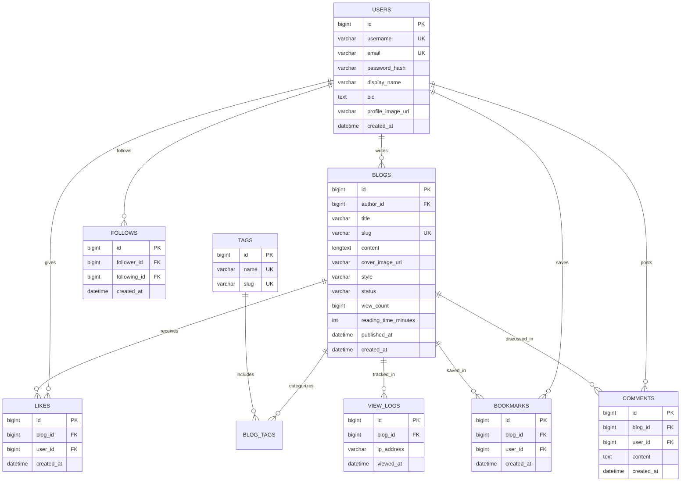

# Inkora — Blog Builder + Social Publishing Platform


> A modern, full-stack publishing platform engineered with **Java 21 LTS**, **Spring Boot 3.3.4**, **MySQL 8.0**, and **React 19** with **Vite**. Features a decoupled presentation engine that renders Markdown stories dynamically across 4 distinct design themes (**Editorial**, **Minimal**, **Neo-Brutalist**, and **Magazine**), backed by a rich social ecosystem (Likes, Bookmarks, Follows, Following Feed, and Discussions).

---

## Table of Contents
- [Architectural Highlights](#architectural-highlights)
- [The 4 Dynamic Presentation Themes](#the-4-dynamic-presentation-themes)
- [Tech Stack](#tech-stack)
- [Database Schema](#database-schema)
- [REST API Reference](#rest-api-reference)
- [Quick Start Guide](#quick-start-guide)
- [Demo Creator Credentials](#demo-creator-credentials)
- [Project Directory Structure](#project-directory-structure)
- [Automated Verification](#automated-verification)

---

## Architectural Highlights

1. **Decoupled Content & Presentation Architecture**:
   Articles are drafted and saved in raw Markdown within MySQL `LONGTEXT`. The presentation theme is stored as a metadata attribute (`EDITORIAL`, `MINIMAL`, `NEO_BRUTALIST`, `MAGAZINE`). The frontend dynamically swaps layout, typography, borders, and micro-interactions on the fly without altering the underlying content.
2. **Stateless JWT Security**:
   Stateless token-based authentication via Spring Security and BCrypt password hashing. Protected endpoints require valid `Authorization: Bearer <token>` headers, while discovery, public reading, and author showcases remain fully accessible to guests and search engines.
3. **View Count Deduplication**:
   Story reads are tracked using a rolling 2-hour IP-address deduplication window (`view_logs` table), preventing artificial view inflation from rapid refreshes.
4. **Collision-Resistant URL Slug Generation**:
   Slugs are automatically generated from article titles (e.g. `Designing Reactive Micro-Frontends` $\rightarrow$ `designing-reactive-micro-frontends-in-2026`) and automatically appended with numerical suffixes if collisions occur (`-1`, `-2`).
5. **Real-Time Social Graph**:
   Full creator following, atomic story liking, reading list bookmarking, and discussion comments with author-level and creator-level moderation.

---

## The 4 Dynamic Presentation Themes

| Theme | Typography & Visual Language | Aesthetic Feel |
| :--- | :--- | :--- |
| **Editorial** | Warm serif (`Playfair / Merriweather`), drop caps, rich pull quotes, subtle warm cream background | Classic New Yorker / literary journal |
| **Minimal** | Monospace headings (`JetBrains Mono / Courier`), high whitespace, distraction-free reading | Clean developer notes & technical documentation |
| **Neo-Brutalist** | Bold sans-serif, 2px/3px thick black borders, hard drop shadows (`shadow-[4px_4px_0px_#000]`), canary yellow & lime highlights | Contemporary indie web & design agency |
| **Magazine** | Modern sans-serif (`Inter / Outfit`), hero split layout, multi-column cards, rich color accents | Wired / Fast Company contemporary digital magazine |

---

## Tech Stack

### Frontend
* **Runtime / Framework**: React 19 (strictly JavaScript — no TypeScript)
* **Build Tool**: Vite 8.3
* **Styling**: Tailwind CSS 3.4 + Custom CSS + Bootstrap 5.3 utilities
* **Routing**: React Router 7 (`react-router-dom`)
* **HTTP Client**: Axios with centralized request/response interceptors
* **Markdown Parser & Sanitizer**: Marked + DOMPurify
* **Icons**: Lucide React

### Backend
* **Language**: Java 21 LTS
* **Framework**: Spring Boot 3.3.4
* **Security**: Spring Security 6 with Stateless JWT Filter + BCrypt Password Encoder
* **Persistence**: Spring Data JPA + Hibernate 6
* **Database**: MySQL 8.0 (InnoDB)
* **Validation**: Jakarta Bean Validation (`@NotBlank`, `@Size`, `@Pattern`)
* **Utilities**: Lombok, Apache Commons / Java IO for file uploads
* **Build Tool**: Maven 3.9 (via turnkey `mvnw.cmd` wrapper)

---

## Database Schema



---

## REST API Reference

### 1. Authentication (`/api/auth`)
| Method | Endpoint | Description | Auth Required |
| :--- | :--- | :--- | :--- |
| `POST` | `/api/auth/register` | Register new user account | No |
| `POST` | `/api/auth/login` | Login and receive Bearer JWT token | No |
| `GET` | `/api/auth/me` | Fetch authenticated user profile | Yes |
| `POST` | `/api/auth/logout` | Client token invalidation | Yes |

### 2. Stories & Discovery (`/api/blogs`)
| Method | Endpoint | Description | Auth Required |
| :--- | :--- | :--- | :--- |
| `GET` | `/api/blogs/explore` | Discovery feed (tab = `trending`, `latest`, `popular`, tag filter) | No |
| `GET` | `/api/blogs/slug/{slug}` | Public story reader by URL slug | No |
| `GET` | `/api/blogs/search` | Full-text query search by title, excerpt, content | No |
| `GET` | `/api/blogs/{id}` | Fetch blog by ID | Yes |
| `POST` | `/api/blogs` | Create a new draft story | Yes |
| `PUT` | `/api/blogs/{id}` | Update title, content, style, or cover image | Yes (Author) |
| `PATCH`| `/api/blogs/{id}/status` | Publish or unpublish story (`PUBLISHED` / `DRAFT`) | Yes (Author) |
| `DELETE`| `/api/blogs/{id}` | Permanently delete story | Yes (Author) |

### 3. Social Engine & Interactions
| Method | Endpoint | Description | Auth Required |
| :--- | :--- | :--- | :--- |
| `POST` | `/api/blogs/{id}/like` | Toggle like on a story | Yes |
| `POST` | `/api/blogs/{id}/bookmark`| Toggle bookmark into personal reading list | Yes |
| `GET` | `/api/dashboard/bookmarks`| Get paginated saved bookmarks | Yes |
| `POST` | `/api/users/{username}/follow`| Toggle follow/unfollow an author | Yes |
| `GET` | `/api/blogs/feed` | Personalized feed of stories from followed authors | Yes |

### 4. Discussions & Comments
| Method | Endpoint | Description | Auth Required |
| :--- | :--- | :--- | :--- |
| `GET` | `/api/blogs/{id}/comments`| Publicly fetch all comments for a story | No |
| `POST` | `/api/blogs/{id}/comments`| Post a response to a story | Yes |
| `DELETE`| `/api/comments/{id}` | Delete comment (Comment Author or Story Creator) | Yes |

### 5. Workspace, Users & Uploads
| Method | Endpoint | Description | Auth Required |
| :--- | :--- | :--- | :--- |
| `GET` | `/api/dashboard/stats` | Analytics summary (views, stories, likes, comments) | Yes |
| `GET` | `/api/dashboard/blogs` | Author stories filterable by status (`ALL`, `PUBLISHED`, `DRAFT`)| Yes |
| `GET` | `/api/users/{username}` | Public author profile and stats | No |
| `GET` | `/api/users/{username}/blogs`| Public author's published stories | No |
| `PUT` | `/api/users/profile` | Update display name, bio, and avatar | Yes |
| `POST` | `/api/uploads/image` | Upload cover images or avatars (`multipart/form-data`) | Yes |
| `GET` | `/api/tags` | List all platform tags with usage count | No |
| `GET` | `/api/health` | Health & uptime probe (`{"status": "UP"}`) | No |

---

## Quick Start Guide

### Prerequisites
1. **Java 21 LTS** (`java -version`)
2. **Node.js 18+** (`node -v`)
3. **MySQL 8.0** running on `localhost:3306` with database `inkora_db`

### Configuration
Verify `backend/src/main/resources/application.properties`:
```properties
spring.datasource.url=jdbc:mysql://localhost:3306/inkora_db?useSSL=false&serverTimezone=UTC&allowPublicKeyRetrieval=true
spring.datasource.username=root
spring.datasource.password=root
app.jwt.secret=404E635266556A586E3272357538782F413F4428472B4B6250645367566B5970
```

### One-Click Launch (Windows)
Double-click `start.cmd` or run:
```powershell
.\run.ps1
```
* Backend will initialize on **`http://localhost:8080`**
* Frontend will launch on **`http://localhost:5173`**
* Browser will automatically open to the Inkora homepage.

### Production Deployment (Docker Compose)
To deploy the entire production stack (MySQL 8 + Spring Boot API + React Nginx SPA) in one command:
```bash
cp .env.example .env
docker compose up -d --build
```
* Frontend live at: `http://localhost`
* Backend live at: `http://localhost:8080/api`
* For cloud platforms (Render, Railway, Vercel, AWS, Linux VPS), refer to the comprehensive [DEPLOYMENT.md](file:///c:/Users/ASUS%20TUF%20F17/OneDrive/Desktop/Create%20Your%20Blog/DEPLOYMENT.md) guide.

### Manual Local Launch

**Terminal 1 — Spring Boot Backend:**
```powershell
cd backend
.\mvnw.cmd spring-boot:run
```

**Terminal 2 — React Frontend:**
```powershell
cd frontend
npm install
npm run dev
```

---

## Demo Creator Credentials

The platform is pre-seeded with two active creator accounts and four published stories representing each dynamic theme:

| Handle | Display Name | Email | Password | Role / Showcase |
| :--- | :--- | :--- | :--- | :--- |
| `@elenarostova` | Elena Rostova | `elena@inkora.io` | `Password123!` | Tech Lead & Architecture Writer |
| `@alexrivera` | Alex Rivera | `alex@inkora.io` | `SecurePassword123!` | Design Engineer & Minimalist |

---

## Project Directory Structure

```
Create Your Blog/
├── run.ps1                  # Turnkey PowerShell launch script
├── start.cmd                # Turnkey Windows Batch launcher
├── stop.cmd                 # Quick process shutdown script
├── README.md                # Comprehensive system documentation
│
├── backend/                 # Spring Boot 3 + Java 21 REST API
│   ├── mvnw.cmd             # Maven Wrapper
│   ├── pom.xml              # Maven dependencies
│   ├── uploads/             # Multi-image file storage
│   └── src/main/java/com/inkora/
│       ├── config/          # SecurityConfig, WebMvcConfig
│       ├── controller/      # REST API Controllers (Auth, Blog, Social, Comment, etc.)
│       ├── dto/             # Request & Response DTOs
│       ├── entity/          # JPA Entities (User, Blog, Tag, Like, Bookmark, Comment, etc.)
│       ├── enums/           # BlogStatus, BlogStyle, Role
│       ├── exception/       # GlobalExceptionHandler & custom exceptions
│       ├── repository/      # Spring Data JPA Repositories
│       ├── security/        # JwtProvider, JwtFilter, UserPrincipal
│       └── service/         # Business Logic & storage services
│
└── frontend/                # React 19 + Vite Application
    ├── index.html           # HTML Entry Point
    ├── package.json         # Scripts & dependencies
    ├── vite.config.js       # Vite proxy (/api -> http://localhost:8080)
    ├── tailwind.config.js   # Tailwind design tokens
    └── src/
        ├── components/
        │   ├── blog/        # BlogRenderer, BlogCard, CommentsSection
        │   ├── common/      # Navbar, Footer, ProtectedRoute
        │   └── dashboard/   # ProfileEditModal, DeleteConfirmModal
        ├── context/         # AuthContext (JWT, Login, Logout, User state)
        ├── pages/           # Home, Explore, BlogDetail, AuthorProfile, Bookmarks, Dashboard, EditorPage
        ├── services/        # api.js, authService, blogService, socialService, commentService
        ├── styles/          # index.css (custom typography, scrollbars, animations)
        └── themes/          # EditorialTheme, MinimalTheme, NeoBrutalistTheme, MagazineTheme
```

---

## Automated Verification

The repository includes standalone end-to-end verification scripts:

```powershell
# Verify Social Engine (Likes, Bookmarks, Follows, Following Feed, Comments)
powershell -ExecutionPolicy Bypass -File backend\test_social_full.ps1

# Verify Full Blog CRUD & Slug Collision Engine
powershell -ExecutionPolicy Bypass -File backend\test_blog_crud.ps1

# Verify Frontend Production Build
cd frontend && npm run build
```

---

*Engineered with precision for writers, designers, and engineers.*
